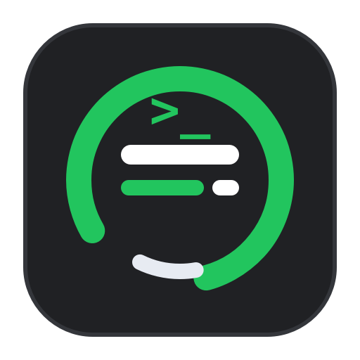
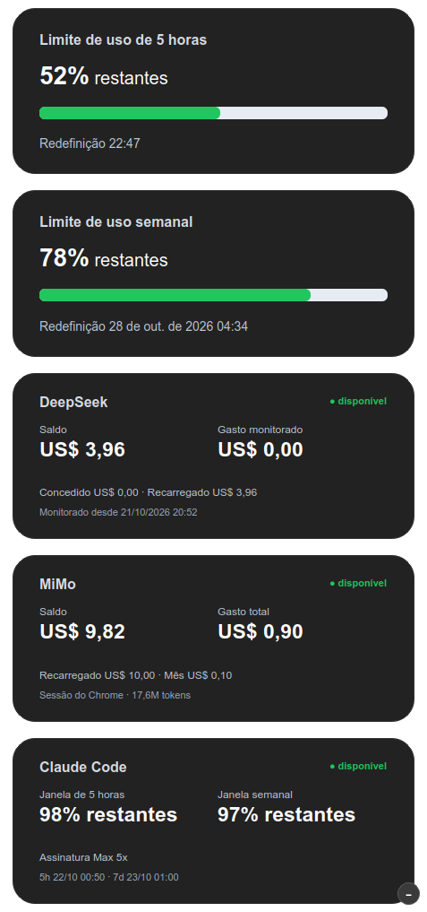
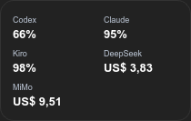

<p align="center">
  
</p>

# Codex Widget

Codex Widget is a small floating desktop widget for monitoring your Codex usage limits and your Kiro, DeepSeek, MiMo and Claude Code balances. It shows the **short usage window** (the 5-hour window today) and the **weekly usage window** exposed by the ChatGPT/Codex account usage endpoint, plus **Claude Code**, **Kiro**, **DeepSeek**, **MiMo** and **OpenAI** cards with subscription usage, credits and saldo/gasto.

> [!NOTE]
> OpenAI restored the short Codex usage window. The widget labels that card from `limit_window_seconds`, so a 5-hour window reads "Limite de uso de 5 horas" and any future 6-hour window reads "Limite de uso de 6 horas" without code changes.

> [!NOTE]
> DeepSeek's public API exposes the **current balance only** (`GET /user/balance`); it has no spend/usage endpoint. The widget measures spend from balance drops between refreshes and persists the ledger locally. Use `--deepseek-spent-baseline` to add spend that happened before the widget started monitoring.

The widget stays on top of the desktop and can be dragged anywhere.

<p align="center">
  
</p>

> [!IMPORTANT]
> Codex Widget reads your local Codex authentication file and uses an internal ChatGPT endpoint. Treat `~/.codex/auth.json` as a secret. Do not commit it, log it, or share it.

## Features

- Floating always-on-top PyQt6 widget
- Codex card with the short and weekly usage windows side by side
- DeepSeek balance and tracked-spend card
- MiMo balance and total-spend card (Chrome session)
- Claude Code card with the 5-hour and weekly subscription windows
- Kiro CLI credit usage card (credits left, used and renewal date)
- OpenAI organization spend card (Admin key), with optional credit balance
- Vertical layout by default, with persisted orientation and size
- Collapsible compact badge with the key numbers
- Click a card to open an enlarged copy next to the panel
- Compact cards: usage cards (Codex, Claude Code, Kiro) carry progress bars under each percentage; balance cards (DeepSeek, MiMo, OpenAI) use a shorter one-line layout
- Plan or balance details next to each card title and a colored availability dot (hover for the text); text that does not fit is elided and shown in full as a tooltip
- Reset times for both windows in the card footnote
- Keyboard resizing for compact desktop placement
- Uses the existing Codex login from `~/.codex/auth.json`

## How Authentication Works

Codex Widget does not ask you to log in separately. It reads the same local authentication file used by Codex:

```text
~/.codex/auth.json
```

From that file it extracts:

- `tokens.access_token` or `tokens.accessToken`
- `tokens.account_id`, `tokens.accountId`, or the `chatgpt_account_id` claim inside `tokens.id_token`
- `tokens.refresh_token` when the access token needs to be refreshed after an authentication failure

It then calls:

```http
GET https://chatgpt.com/backend-api/wham/usage
Authorization: Bearer <access_token>
chatgpt-account-id: <account_id>
Accept: application/json
```

The response can contain `rate_limit.primary_window` and `rate_limit.secondary_window`. Codex Widget parses:

- `limit_window_seconds = 604800` as the **weekly** window
- any other non-null `limit_window_seconds` as the **short** window (today `18000`, the 5-hour window)

Both windows are shown side by side in a single **Codex** card: the short window on the left (labelled from `limit_window_seconds`, so `21600` reads `Janela de 6 horas`) and the weekly window on the right. A window missing from the response reads `Indisponível` and renders no bar.

> [!NOTE]
> `/backend-api/wham/usage` is not a public OpenAI Platform API. It is the same internal account usage endpoint used by Codex-related clients and may change without notice.

## How the DeepSeek Card Works

The DeepSeek card uses your API key from `DEEPSEEK_API_KEY` (or `--deepseek-api-key`) and calls:

```http
GET https://api.deepseek.com/user/balance
Authorization: Bearer <DEEPSEEK_API_KEY>
Accept: application/json
```

The response returns `is_available` and `balance_infos[]` with `currency`, `total_balance`, `granted_balance`, and `topped_up_balance`. The card shows the total balance, the granted/topped-up split, and the currency reported by the API (`US$`, `CN¥`, `€`, `R$`).

DeepSeek does not expose spend or usage through its public API. The widget therefore infers spend from **balance decreases between refreshes**:

- balance drop → added to `Gasto monitorado`
- balance increase (top-up) → recorded, never counted as negative spend
- the ledger is persisted at `~/.local/state/codex-widget/deepseek-spend.json` (override with `--deepseek-state-file`)

Because only the current balance is available, spend from before the first run is not included. To include it, pass the total spent so far from the DeepSeek dashboard:

```bash
codex-widget --deepseek-spent-baseline 12.34
```

With a baseline the label becomes `Gasto total` (baseline + observed spend). Without it, the label stays `Gasto monitorado` and the footnote shows when monitoring started.

## How the MiMo Card Works

MiMo's platform has no API-key-authenticated balance/usage endpoint: `/api/v1/balance` and `/api/v1/usage` on `platform.xiaomimimo.com` require the Xiaomi account session, and the API key only authenticates inference (`api.xiaomimimo.com`). The widget therefore reuses the session already present in your local **Google Chrome** profile:

1. finds the Chrome profile whose cookie database contains `platform.xiaomimimo.com` cookies (or uses `--mimo-chrome-profile Default`)
2. decrypts the session cookies locally using the key stored in the GNOME keyring (`Chrome Safe Storage`)
3. calls, with those cookies only:

```http
GET https://platform.xiaomimimo.com/api/v1/balance
GET https://platform.xiaomimimo.com/api/v1/usage
GET https://platform.xiaomimimo.com/api/v1/accumulatedRechargeAmount
```

The card shows the balance, the all-time spend (`costUsage.totalCost`), the current-month spend, the accumulated recharge and the total tokens. When the session expires, the card shows `Sessão do Chrome expirada`; log in again at `https://platform.xiaomimimo.com`.

The cookie database is copied to a temporary directory before reading, so a running Chrome does not block the widget. Decrypted cookies stay in memory and are never logged.

## How the Claude Code Card Works

The Claude Code card reads the logged-in Chrome session for `claude.ai` (no Claude Code OAuth token required). It calls the site's internal JSON endpoints:

```http
GET https://claude.ai/api/organizations
GET https://claude.ai/api/organizations/<chat_org_uuid>/usage
Cookie: <Chrome session cookies>
```

The widget selects the organization with the `chat` capability, then displays the remaining percentages and reset times from `five_hour` and `seven_day`. The plan comes from that organization's rate-limit tier. If the session expires, sign in at `https://claude.ai` in Chrome. Use `--claude-chrome-profile` when the desired session is not in the automatically selected Chrome profile. The widget does not read or rewrite `~/.claude/.credentials.json`.

## How the Kiro Card Works

The Kiro card reuses the Kiro CLI login. It reads the bearer token stored by `kiro-cli` in `~/.local/share/kiro-cli/data.sqlite3` (table `auth_kv`, key `kirocli:odic:token`, opened read-only) and calls:

```http
POST https://codewhisperer.us-east-1.amazonaws.com/
X-Amz-Target: AmazonCodeWhispererService.GetUsageLimits
Content-Type: application/x-amz-json-1.0
Authorization: Bearer <kiro-cli access token>
```

From `usageBreakdownList` it takes the `CREDIT` entry and shows the remaining percentage with a bar, `currentUsageWithPrecision` of `usageLimitWithPrecision` (for example `176,6 de 10.000`), the plan from `subscriptionInfo.subscriptionTitle` and the renewal date from `nextDateReset`. When overage is enabled, the footnote shows the consumed overage, its cap and the charges so far.

The widget never refreshes or rewrites the Kiro token, because the SSO refresh token rotates and that would invalidate the CLI's own session. The token is renewed whenever you use `kiro-cli`; if it has expired the card reads `Sessão do Kiro expirada, rode kiro-cli login`.

## How the OpenAI Card Works

The OpenAI card reads organization costs from the Admin API:

```http
GET https://api.openai.com/v1/organization/costs?start_time=<unix>&bucket_width=1d&limit=180
Authorization: Bearer <admin key>
```

This endpoint requires an **Admin key** (`sk-admin-…`) with the `api.usage.read` scope, created at platform.openai.com → Settings → Organization → Admin keys. A project key (`sk-proj-…`) returns HTTP 403 and the card says so. Daily buckets are summed into spend for today, for the current month, and for the tracked window; pagination follows `next_page`.

> [!NOTE]
> OpenAI exposes **no credit-balance endpoint**, not even to Admin keys (confirmed by OpenAI support in September 2026); the balance lives only in the browser dashboard. Set `openai_credits_purchased` (and optionally `openai_credits_since`, default: start of the current month) to display `Saldo = créditos informados − custo acumulado`. Without it the card shows month and day spend only.

## Configuration File

GUI launchers (desktop entries, app menus) do not inherit the shell environment. The widget therefore also reads `~/.env` directly, so keys exported there work without any extra setup; anything not found there can be set in the config file:

```text
~/.config/codex-widget/config.json
```

```json
{
  "deepseek_api_key": "sk-...",
  "deepseek_base_url": "https://api.deepseek.com",
  "deepseek_state_file": "~/.local/state/codex-widget/deepseek-spend.json",
  "deepseek_spent_baseline": "12.34",
  "mimo_chrome_profile": "Default",
  "claude_chrome_profile": "Default",
  "openai_admin_key": "sk-admin-...",
  "openai_credits_purchased": "50.00",
  "openai_credits_since": "2026-09-01"
}
```

All keys are optional. Restrict the file:

```bash
chmod 600 ~/.config/codex-widget/config.json
```

Resolution order for credentials and endpoints:

1. command-line flag (`--deepseek-api-key`, `--openai-admin-key`, …)
2. exported environment variable (`DEEPSEEK_API_KEY`, `OPENAI_ADMIN_API_KEY` or `OPENAI_ADMIN_KEY`, …)
3. `~/.env` (`KEY=value` lines, `export KEY=value` and quotes supported; override the path with `CODEX_WIDGET_ENV_FILE`)
4. config file
5. built-in default

Set `CODEX_WIDGET_CONFIG=/path/to/config.json` (or `--config-file`) to use another file.

## Requirements

- Linux desktop environment
- Python 3.10+
- A working Codex login at `~/.codex/auth.json`
- DeepSeek API key in `~/.env`, `DEEPSEEK_API_KEY` or `~/.config/codex-widget/config.json` for the DeepSeek card
- Google Chrome logged in at `https://platform.xiaomimimo.com` for the MiMo card
- Google Chrome logged in at `https://claude.ai` for the Claude Code card
- Kiro CLI logged in (`kiro-cli login`) for the Kiro credits card
- OpenAI Admin key in `~/.env` (`OPENAI_ADMIN_API_KEY`), the environment or the config file, for the OpenAI card
- GNOME Keyring (libsecret) holding the Chrome Safe Storage key
- PyQt6

## Installation

Create and activate a virtual environment:

```bash
cd /home/fabio/projetos/codex-widget
python3 -m venv .venv
source .venv/bin/activate
```

Install the project:

```bash
pip install -r requirements.txt
pip install -e .
```

After installation, the package provides this command:

```bash
codex-widget
```

You can also run the local launcher directly:

```bash
python3 scripts/codex_usage_widget.py
```

## Usage

Start the widget:

```bash
codex-widget
```

Optional arguments:

```bash
codex-widget --auth-file ~/.codex/auth.json
codex-widget --refresh-seconds 30
codex-widget --base-url https://chatgpt.com/backend-api
codex-widget --deepseek-api-key sk-...          # defaults to DEEPSEEK_API_KEY
codex-widget --deepseek-base-url https://api.deepseek.com
codex-widget --deepseek-state-file ~/.local/state/codex-widget/deepseek-spend.json
codex-widget --deepseek-spent-baseline 12.34    # spend before monitoring started
codex-widget --mimo-chrome-profile Default      # defaults to auto-detection
codex-widget --claude-chrome-profile Default   # defaults to auto-detection
codex-widget --openai-admin-key sk-admin-...   # defaults to OPENAI_ADMIN_KEY
codex-widget --openai-credits-purchased 50.00  # enables the OpenAI balance
codex-widget --openai-credits-since 2026-09-01 # window summed for that balance
codex-widget --config-file ~/.config/codex-widget/config.json
```

The widget refreshes usage and balances automatically. The default refresh interval is 60 seconds. The default layout is vertical; `Ctrl+H` switches between vertical and horizontal.

## Layout, Size and Collapsed View

The default layout is **vertical**. View preferences are persisted per user in:

```text
~/.local/state/codex-widget/ui.json
```

- `horizontal` / `orientation_locked` — layout chosen with `Ctrl+H` (the forced orientation survives restarts)
- `scale` — widget size chosen with `Ctrl++` / `Ctrl+-`
- `collapsed` — collapsed state
- `screen_name` / `offset_x` / `offset_y` — monitor and position relative to its available area, saved when you drag the widget, collapse/expand it, or close it

On the first run the widget shrinks to fit the available screen area. Subsequent runs restore the saved size and position on the same monitor, even if the monitor's virtual coordinates changed. If that monitor is disconnected, the widget opens on the primary screen instead.

The `–` button at the bottom-right collapses the widget into a compact badge:

<p align="center">
  
</p>

The badge shows the Codex and Claude percentages plus the DeepSeek and MiMo balances. It is anchored at the `–` button's corner and constrained to that monitor, not the primary monitor. Expanding restores the previous position on the same monitor; if the badge was dragged to another monitor, the panel expands from its new corner. The collapsed state also survives restarts.

If a saved size no longer fits the current screen, it is reduced automatically on startup.

## Enlarged Card View

Clicking a card opens an enlarged copy of it in a frameless window placed next to the panel: to the right when the screen has room, otherwise to the left, below, or above, always clamped to the monitor under the panel. The copy follows the live data, so a refresh while it is open updates it too.

Clicking the enlarged card closes it, as does clicking the same card again, collapsing the panel, dragging the panel, or closing the widget. Clicking another card swaps the content instead of opening a second window. Dragging from a card still moves the panel and does not open the enlarged view.

## Keyboard Shortcuts

| Shortcut | Action |
| --- | --- |
| `Ctrl++` | Increase widget size |
| `Ctrl+=` | Increase widget size on keyboards where `+` is typed with `=` |
| `Ctrl+-` | Decrease widget size |
| `Ctrl+H` | Toggle horizontal/vertical layout |
| `Q` | Quit |

The widget can also be dragged with the left mouse button.

## Creating a Desktop Shortcut

This repository includes `codex-widget.desktop` as a base desktop entry:

```ini
[Desktop Entry]
Type=Application
Name=Codex Widget
Comment=Floating desktop widget for Codex usage limits
Exec=/home/fabio/projetos/codex-widget/.venv/bin/codex-widget %u
Terminal=false
Icon=/home/fabio/projetos/codex-widget/assets/codex_logo.png
Categories=Utility;
```

To install it for your user:

```bash
mkdir -p ~/.local/share/applications
cp /home/fabio/projetos/codex-widget/codex-widget.desktop ~/.local/share/applications/
update-desktop-database ~/.local/share/applications 2>/dev/null || true
```

Make sure the `Exec` path points to the installed command inside your virtual environment:

```text
/home/fabio/projetos/codex-widget/.venv/bin/codex-widget
```

Make sure the `Icon` path points to:

```text
/home/fabio/projetos/codex-widget/assets/codex_logo.png
```

If you installed the project somewhere else, edit both paths before copying the desktop file.

## Project Structure

```text
assets/codex_logo.png          Project icon
codex-widget.desktop           Desktop launcher template
requirements.txt               Runtime dependencies
scripts/codex_usage_widget.py  Local development launcher
src/codex_widget/main.py       Application entry point
src/codex_widget/config.py     Persistent user config (API keys and overrides)
src/codex_widget/dotenv.py     Credential lookup in `~/.env` for GUI launchers
src/codex_widget/usage.py      Codex auth and usage fetcher
src/codex_widget/deepseek.py   DeepSeek balance fetcher and spend ledger
src/codex_widget/chrome_cookies.py  Chrome cookie database reader/decryptor
src/codex_widget/mimo.py       MiMo console API client
src/codex_widget/claude.py     Claude browser-session usage client
src/codex_widget/kiro.py       Kiro CLI credit usage client
src/codex_widget/openai_costs.py  OpenAI Admin API costs client
src/codex_widget/ui_state.py   Persisted layout, size and collapsed state
src/codex_widget/view_model.py Usage formatting for the UI
src/codex_widget/widget.py     PyQt6 floating widget
```

## Security Notes

- The widget never prints your access token, DeepSeek API key or Chrome session cookies.
- The widget reads `~/.codex/auth.json` locally and `DEEPSEEK_API_KEY` from the environment.
- The Codex access token is only sent to `https://chatgpt.com/backend-api/wham/usage`.
- The DeepSeek API key is only sent to `https://api.deepseek.com/user/balance`.
- MiMo session cookies are decrypted locally with the Chrome Safe Storage key from the GNOME Keyring and are only sent to `https://platform.xiaomimimo.com`.
- Claude session cookies are sent only to `https://claude.ai`; the widget never reads or writes Claude Code OAuth tokens.
- The Kiro token is read from the Kiro CLI database in read-only mode and is only sent to `https://codewhisperer.us-east-1.amazonaws.com`; the widget never writes to that database.
- `~/.env` is read only for the specific credential names the widget needs; other secrets in that file are ignored and never logged.
- The OpenAI Admin key is only sent to `https://api.openai.com/v1/organization/costs` and is read-only for usage data.
- The spend ledger contains balances and inferred spend only (`~/.local/state/codex-widget/deepseek-spend.json`).
- The UI state file (`~/.local/state/codex-widget/ui.json`) contains only layout, scale and collapsed state.
- The config file (`~/.config/codex-widget/config.json`) stores API keys in plain text; keep it at mode `600` and out of version control.
- If usage or balance fetching fails, the widget shows an error message instead of exposing credentials.

If you suspect your local Codex credentials, DeepSeek API key, MiMo session, Kiro session or Claude Code session were exposed, rotate/revoke them and log in again.
